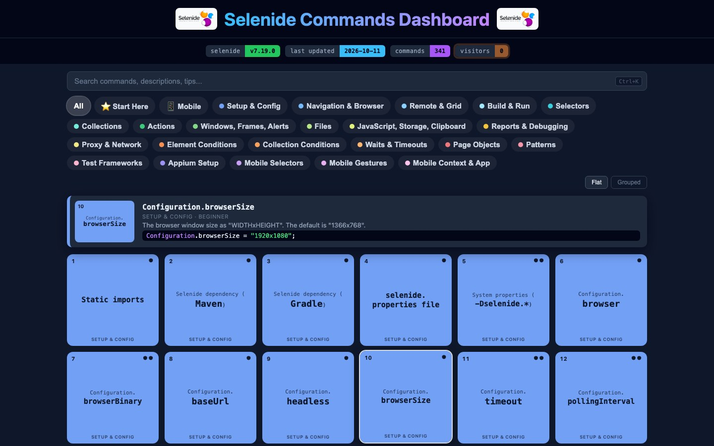
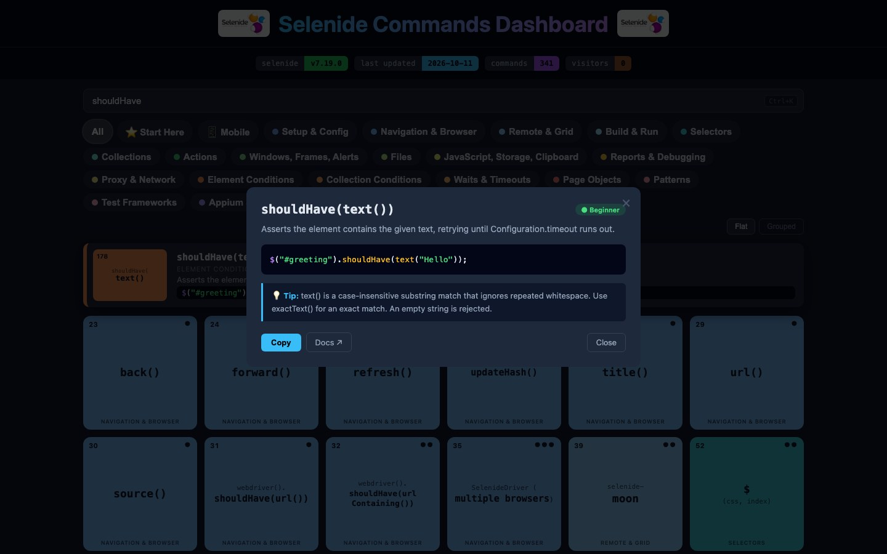

# Selenide Commands Cheat Sheet

[](https://youvegotnigel.github.io/selenide-commands-cheat-sheet/)
[](https://selenide.org/)

An interactive browser-based reference for **Selenide** (Java web UI testing) and **selenide-appium** (mobile testing through Selenide's own API). Browse commands, read short examples, and jump to the official docs in one place.

Pinned versions: Selenide **7.19.0**, selenide-appium **7.19.0**, Appium java-client **11.0.0**. Every entry is checked against the sources jars of that release.


*Periodic-table style grid -> every command is a tile, coloured by category family, with a live preview panel*


*Command modal -> description, code snippet, copy button, and docs link*

## Features
- Periodic-table grid: each command is a numbered tile with level dots, a small prefix and a large key
- Keyboard navigation over the grid (arrow keys, Home, End) and a hover/focus preview panel on desktop
- Difficulty levels: Beginner, Intermediate, and Advanced
- Category filter tabs, plus a **Mobile** filter for selenide-appium entries
- Flat and Grouped view modes
- Search across name, description, tip, and code
- Copy-to-clipboard on every snippet
- Direct links to the official Selenide docs and Javadoc

## Categories
Setup & Config, Navigation & Browser, Selectors, Actions, Element Conditions, Collection Conditions, Collections, Waits & Timeouts, Page Objects, Windows/Frames/Alerts, Files, Proxy & Network, JavaScript/Storage/Clipboard, Reports & Debugging, Test Frameworks, Remote & Grid, Patterns, Build & Run, Appium Setup, Mobile Selectors, Mobile Gestures, Mobile Context & App

## How to Use
1. Open the [Selenide commands cheat sheet](https://youvegotnigel.github.io/selenide-commands-cheat-sheet/) in your browser
2. Use **Start Here** to see beginner commands if you are new to Selenide
3. Use **Mobile** to see the entries that work with selenide-appium
4. Click any tile to see the full description, code example, and tip
5. Use the **search bar** to find commands by name, description, or keyword
6. Use the **category filter tabs** to focus on one area at a time
7. Toggle **Grouped** view to see commands organised under their category headers
8. Click **Docs** in the modal to open the official documentation

## Project Structure
```text
selenide-commands-cheat-sheet/
├── images/
├── js/
│   ├── app.js              # render, filters, search, modal, meta-bar
│   ├── highlight.js        # dependency-free Java / shell / XML highlighter
│   ├── tile.js             # tile anatomy: name split, break points, key size
│   ├── grid-keys.js        # roving tabindex and arrow keys over the grid
│   ├── inspector.js        # desktop hover/focus preview panel
│   ├── visitor-counter.js  # visitor count (Supabase)
│   ├── visitor-display.js
│   ├── popular-commands.js # command-view tracking (off for now)
│   ├── versions.json       # pinned Selenide / selenide-appium / java-client versions
│   ├── meta.json           # last-updated date, stamped by CI
│   └── data/
│       ├── index.js        # imports each category and exports `categories`
│       ├── config.js ... cli.js              # 18 web categories
│       └── appium-setup.js ... mobile-context.js   # 4 mobile categories
├── tests/
│   ├── helpers/
│   ├── content/            # per-category guards, expected values from the sources jar
│   ├── cheatsheet.spec.js
│   ├── grid-cells.spec.js
│   ├── grid-interactions.spec.js
│   └── data-integrity.spec.js
├── supabase/               # visitor counter migration and Edge Function
├── docs/                   # design specs and implementation plans
├── .github/workflows/      # test, stamp-date, cheatsheet-sync
├── .claude/skills/selenide-release-sync/   # how to sync the data with a new release
├── index.html
├── style.css
├── playwright.config.js
├── package.json
└── LICENSE
```

## Development
There is no build step and there are no runtime dependencies.

```bash
npm install
npm run fetch:sources   # download the pinned sources jars into .cache/sources/
npm test                # Playwright: chromium, iPhone 16, Pixel 7
npm run test:scripts    # node:test unit tests for the release-sync scripts
npm run lint
npm run format:check
npm run check:links     # every docs URL and anchor resolves (needs network)
```

The site is plain JavaScript, so it is tested with Playwright even though the content is about Selenide.

## Contributing
### Adding a New Command
Verify the API in `.cache/sources/` first, then open the relevant category file in [js/data/](js/data/) and add an object to its `items` array:

```javascript
{
  name:  'shouldHave(text())',
  level: 'beginner',        // 'beginner' | 'intermediate' | 'advanced'
  platform: 'both',         // 'web' | 'mobile' | 'both'
  desc:  'Plain-English explanation of what it does.',
  tip:   'When to use it, gotchas, or alternatives.',
  docs:  'https://selenide.org/javadoc/current/com/codeborne/selenide/Condition.html#text(java.lang.String)',
  code:  `$("#greeting").shouldHave(text("Hello"));`
},
```

Names must be unique across all categories and must not contain `<` or `>`. Do not use em-dashes or en-dashes. Inside a template literal write `\${` for a literal `${`.

### Adding a New Category
Create a new file in [js/data/](js/data/) that default-exports the category object:

```javascript
/** @type {import('./index.js').Category} */
export default {
  cat:   'CategoryName',
  cls:   'category-css-class',
  color: '#hexcolor',
  items: [ /* commands go here */ ]
};
```

Then register it in [js/data/index.js](js/data/index.js), add a `.category-css-class` fill rule in [style.css](style.css) in the same color (dark text must reach 4.5:1 contrast), add a content spec in `tests/content/`, and run `npm test`.

### Keeping up with Selenide releases
A scheduled workflow checks for drift on the 1st and 15th of each month and opens a pull request. To sync locally, ask Claude Code to "sync the cheat sheet to the latest Selenide".

## Author
* **Nigel Mulholland** - [Linkedin](https://www.linkedin.com/in/nigel-mulholland/)
